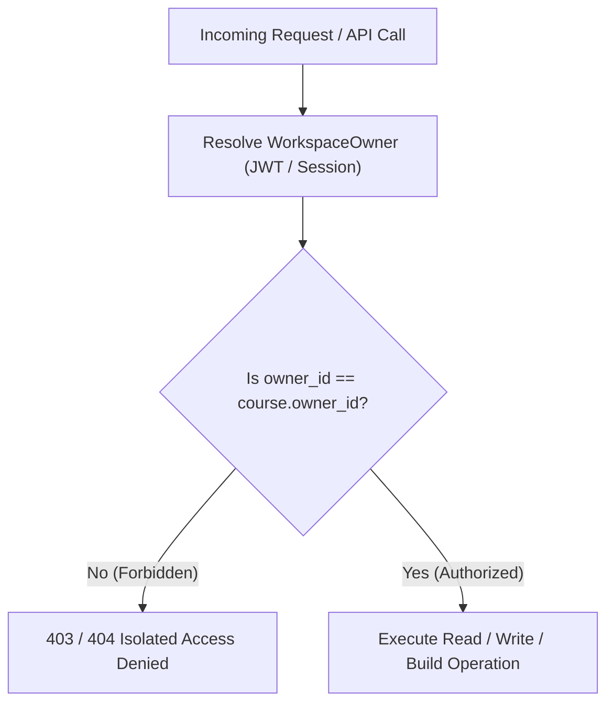
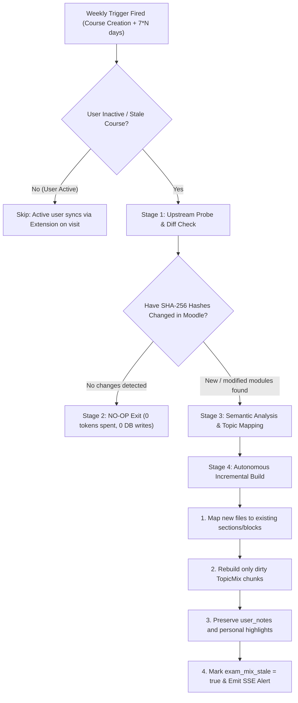
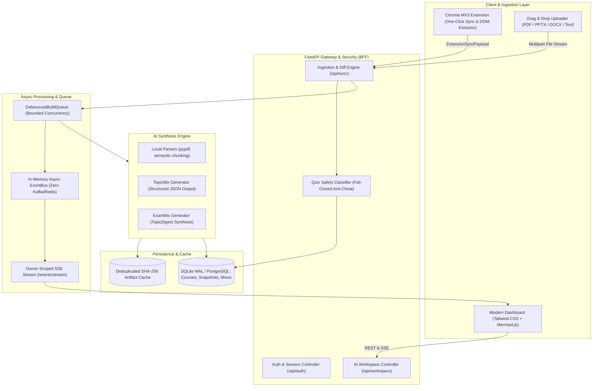
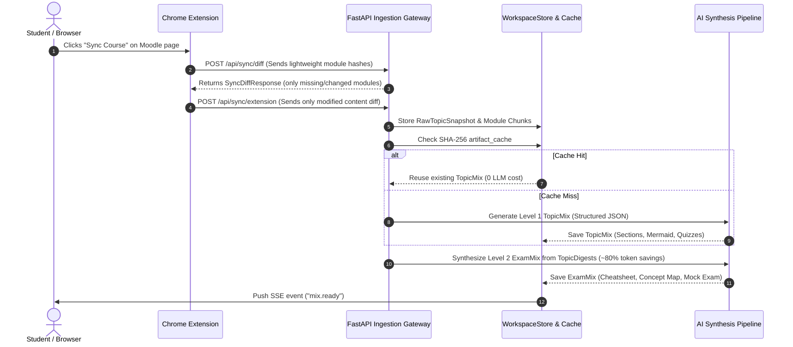

# 🎓 Universal Moodle LMS AI Workspace & Event Connector

[](https://fastapi.tiangolo.com)
[](https://www.python.org/)
[](LICENSE)
[](docker-compose.yml)
[]()

> An enterprise-grade, privacy-first, **event-driven AI learning platform** that connects to student accounts across **any Moodle LMS installation**, ingests syllabus materials and deadlines, filters exams via a fail-closed anti-cheat gate, and synthesizes personalized interactive study courses, adaptive test simulations, and automated study schedules.

---

## 📑 Table of Contents

1. [Product Concept & Vision](#-1-product-concept--vision)
2. [Creator Permissions & Autonomous Weekly Re-indexing](#-2-creator-permissions--autonomous-weekly-re-indexing)
3. [System Architecture & Infrastructure](#-3-system-architecture--infrastructure)
4. [Ingestion & Multi-Tier Mix Pipeline](#-4-ingestion--multi-tier-mix-pipeline)
5. [Exam Security & Anti-Leak Gate](#-5-exam-security--anti-leak-gate)
6. [Adaptive Learning, AI Coach & Gamification](#-6-adaptive-learning-ai-coach--gamification)
7. [Team Role Split & Seam Ownership](#-7-team-role-split--seam-ownership)
8. [Unified Data Contracts & API Reference](#-8-unified-data-contracts--api-reference)
9. [Quick Start & Local Setup](#-9-quick-start--local-setup)
10. [Docker & Cloud Deployment](#-10-docker--cloud-deployment)
11. [Testing & Verification](#-11-testing--verification)

---

## 💡 1. Product Concept & Vision

### 1.1 The Core Problem
Traditional university Learning Management Systems (LMS) like Moodle suffer from fundamental UX and architectural limitations:
* **Passive PDF graveyards**: Course pages are uncurated dumps of 80-page slide decks, unstructured notes, and dead links.
* **Fragile authentication**: Sessions expire quickly under university Google/Microsoft SSO, breaking long-running sync scripts.
* **Lack of adaptive feedback**: Students prepare for exams blindly without knowing their conceptual weak spots.
* **Cognitive overload & missed deadlines**: Assignments and quizzes are scattered across multiple sub-menus with inconsistent due dates.

### 1.2 The Solution: Universal AI Course Workspace
This project provides a modern web platform (with Chrome Extension companion and mobile-ready PWA architecture) that bridges Moodle and AI:
1. **Zero-friction ingestion**: A 1-click Chrome Extension extracts live course DOM, attachments, and deadlines without F12 scraping or credential exposure.
2. **"Mix of Mixes" (`TopicMix` → `ExamMix`)**: Generates interactive structured textbooks, Mermaid diagrams, flashcards, and synthetic practice questions, then compresses them into a high-yield exam preparation suite (~70–80% LLM token savings).
3. **AI Study Coach ("Наглядач")**: Slot-based schedule planner based on upcoming deadlines, target scores (60% pass vs 90%+ mastery), and Duolingo-style progress tracking.
4. **Ironclad exam safety**: Fail-closed filtering prevents accidental scraping or leakage of real timed exams.

---

## 🔒 2. Creator Permissions & Autonomous Weekly Re-indexing

A central business requirement of the platform is strict course ownership coupled with autonomous, zero-waste background re-indexing.

### 2.1 Creator-Only Editing (Strict Tenant Isolation)
* **Exclusive write rights**: When a user creates or imports a course, **only that user (`owner_id`) has permission to edit**, update tools, modify personal notes, or trigger builds for that course.
* **Cryptographic tenant resolution**: Each request is authenticated via signed JWT workspace tokens (`moodle:<host>:<user_id>` for authenticated Moodle users, or `ws:<uuid>` for isolated guest/local sessions).
* **Multi-tenant storage**: All database tables (`workspace_courses`, `topic_snapshots`, `module_chunks`, `topic_mixes`, `exam_mixes`, `quiz_telemetry`) enforce compound primary keys `(owner_id, course_id)`. Cross-tenant data leakage is physically blocked at the database query layer.



### 2.2 Autonomous Weekly Background Re-Indexing (Stale Course Auto-Updater)
When a user has not visited a course for an extended period, an automated background worker ensures the course materials stay up to date without wasting API tokens or destroying user edits.

#### Execution Cadence
* Runs **periodically once a week**, starting from the exact timestamp the course was initially created.

#### The 4-Stage Self-Healing Algorithm



1. **Stage 1 (Upstream Hash Probe)**: The worker queries Moodle upstream for the course's module and section structures, generating SHA-256 content hashes (`module_hash`, `file_hashes`).
2. **Stage 2 (No-Op Gate)**: If the calculated hashes match existing `known_hashes`, **no work is performed**. No LLM tokens are consumed, and no database writes take place.
3. **Stage 3 (Semantic Topic Mapping)**: If new materials (PDFs, docs, assignments, readings) are discovered:
   * The local parser extracts raw text without calling external LLMs.
   * The chunker identifies which section, module, or knowledge block the new content belongs to.
4. **Stage 4 (Autonomous Incremental Build)**:
   * The new content is appended to the corresponding topic snapshot as an updated module chunk.
   * Only the affected `TopicMix` is regenerated (`has_upstream_update = true`), while **preserving student `user_notes`**.
   * The course's `exam_mix_stale` flag is set to `1`.
   * A real-time notification (`mix.update_available`) is pushed to the student's notification center.

---

## 🏗️ 3. System Architecture & Infrastructure

The application follows an **Event-Driven, Asynchronous Backend-For-Frontend (BFF)** architecture with clean layer separation.



### Architectural Highlights
* **Zero credential storage**: Moodle passwords and session cookies are never stored in the database. Client communication uses encrypted, HttpOnly, SameSite=Lax signed JWT session cookies.
* **Zero external messaging dependencies**: Academic event dispatching and background jobs use Python's built-in `asyncio.Queue` and debounce patterns—no Redis, RabbitMQ, or Celery required for standard deployments.
* **Fail-safe database**: SQLite configured with Write-Ahead Logging (`PRAGMA journal_mode=WAL`) and `PRAGMA busy_timeout=5000` for high-throughput concurrent reads and writes.

---

## 🔄 4. Ingestion & Multi-Tier Mix Pipeline

To prevent prohibitive LLM token costs and latency, the system employs a three-tier hierarchical synthesis model:



### 4.1 Level 0: `RawTopicSnapshot` & Module Chunks
* Immutable, raw text extracted locally from Moodle modules, uploaded PDFs, or HTML descriptions.
* Uses deterministic SHA-256 hashing: `compute_content_hash(f"{title}\n{content_text}")`.
* Upstream edits trigger diff alerts (`has_upstream_update = true`) rather than destructive overwrites.

### 4.2 Level 1: `TopicMix` (Atomic Topic Mastery)
* Represents an individual topic or lecture module.
* Controlled by user-selected `CourseToolsConfig` checkboxes:
  * **Interactive Textbook**: Chunked sections with markdown formatting.
  * **Mermaid Diagrams**: Declarative flowchart/mindmap syntax rendered client-side.
  * **Visual Cards**: Conceptual summaries and prompts.
  * **Spaced Repetition Flashcards**: Front/back key terminology cards.
  * **Synthetic Practice Quizzes**: Multiple-choice questions synthesized from lecture concepts (never scraped exam questions).
  * **User Notes**: Dedicated field preserved across all upstream syncs.

### 4.3 Level 2: `ExamMix` ("Мікс міксів" — Synthesis for Exam Prep)
* Synthesizes cross-topic knowledge into an all-in-one exam study module.
* **Token Optimization**: Built **not** from 500 pages of raw PDFs, but from compact `TopicDigest` summaries (~200–400 tokens per topic). This delivers a **70–80% token cost reduction**.
* **Artifacts Generated**:
  * Master Markdown Cheatsheet.
  * Comprehensive Mermaid Course Concept Map.
  * Multi-topic Mock Exam Simulation.
  * Personalized **Weak Spots Focus** generated dynamically from telemetry on missed quiz questions.

---

## 🛡️ 5. Exam Security & Anti-Leak Gate

A common risk with educational AI tools is accidentally scraping and leaking actual university midterms, graded quizzes, or confidential exam items.

### 5.1 Why Naive Time-Window Rules Fail
Filtering solely by duration (e.g. `< 1.5 hours`) is inadequate: many university midterms are open for submission over a 24–48 hour window with a strict 45-minute countdown timer once started.

### 5.2 The Fail-Closed `QuizSafetyMetadata` Classifier
All incoming activities pass through `QuizSafetyMetadata.classify_safety()`. Any activity not meeting strict practice criteria is treated as a **`restricted_exam`**:

```python
def classify_safety(self) -> ExamSafetyClassification:
    # 1. Safe Exam Browser mandatory -> restricted
    if self.requires_seb:
        return "restricted_exam"
    # 2. Hard countdown timer set -> restricted
    if self.timelimit_seconds is not None and self.timelimit_seconds > 0:
        return "restricted_exam"
    # 3. Limited attempts (graded evaluation) -> restricted
    if self.attempts is not None and self.attempts > 0:
        return "restricted_exam"
    # 4. Immediate feedback/answers disallowed by instructor -> restricted
    if self.review_correctness_allowed is False:
        return "restricted_exam"
    # 5. Short access availability window (<= 4 hours) -> restricted
    if self.timeopen and self.timeclose and (0 < self.timeclose - self.timeopen <= 14400):
        return "restricted_exam"
    # 6. Title indicates midterm, final, or control work -> restricted
    if any(h in self.name.lower() for h in ("іспит", "екзамен", "контрольн", "midterm", "final")):
        return "restricted_exam"
    # Only explicitly untimed, unlimited self-checks are permitted
    if self.attempts == 0 and (self.timelimit_seconds is None or self.timelimit_seconds == 0):
        return "self_test"
    return "restricted_exam"
```

> [!IMPORTANT]
> **Strict Read-Only & Zero-Leak Policy**:
> * Activities flagged as `restricted_exam` **never have their questions or content stored in the database or fed to LLMs**.
> * The platform records only their deadline metadata (`due_at`) for calendar and schedule alerts.
> * The system maintains a strict **Read-Only** stance towards Moodle: it contains zero automated test-submission or quiz-answering functionality.

---

## 🎯 6. Adaptive Learning, AI Coach & Gamification

```
   ┌─────────────────────────────────────────────────────────────────┐
   │ 🎯 Target Score: 85% (Advanced Depth)                           │
   │ [■■■■■■■■■■■■■■■■■■■■■■■■■■■■■□□□□□] 72% Course Mastery         │
   ├─────────────────────────────────────────────────────────────────┤
   │ 📅 AI Coach: Next Study Slot Today                              │
   │ 🕒 16:00 - 17:30 ➔ Operating Systems: Virtual Memory & Page Tables│
   ├─────────────────────────────────────────────────────────────────┤
   │ ⚠️ Weak Spot Detected: 2 missed attempts in "Pipelining Hazards"│
   │ ➔ ExamMix has automatically injected targeted remediation tasks │
   └─────────────────────────────────────────────────────────────────┘
```

1. **Target Score Depth Selector (60% to 100%)**:
   * **60% Target**: Synthesizes high-level executive summaries, core formulas, and essential pass-level concepts across all topics.
   * **90%+ Target**: Generates deep dives, edge cases, tricky practice questions, and nuanced analytical exercises.
2. **Dynamic Weak-Spot Remediation**:
   * Student quiz submissions generate privacy-safe telemetry (`QuizAttemptRequest`).
   * When questions in a topic are answered incorrectly, the system records the deficiency in `quiz_telemetry`.
   * The next `ExamMix` build automatically includes these topics under `weak_spots_focus` with custom targeted drill exercises.
3. **Smart Study Schedule (AI Coach / "Наглядач")**:
   * Evaluates syllabus deadlines, assignment due dates, and remaining unread modules.
   * Constructs concrete daily time slots (e.g. *"Tuesday 17:00–18:30: Review Discrete Math Graph Theory"*).
   * Pushes urgent reminders via browser notifications and real-time SSE streams.
4. **Duolingo-Style Progress & Peer Benchmarking**:
   * Progress levels (Novice → Competent → Master).
   * Anonymous, privacy-preserving percentile comparison against other students enrolled under the same course ID.

---

## 👥 7. Team Role Split & Seam Ownership

To guarantee velocity and eliminate merge conflicts, clear engineering seams are established across the team:

| Role | Domain Ownership | Detailed Planned Deliverables |
| :--- | :--- | :--- |
| **Backend Engineer** | Data collection, exam security filter, hashing/diff, DB & APIs | 1. Implement `POST /api/sync/extension` and manual Drag & Drop endpoints (`PDF/PPTX/DOCX`).<br>2. Enforce `QuizSafetyMetadata.classify_safety()` fail-closed gate.<br>3. Compute SHA-256 `source_hash` and pre-flight diff detection (`POST /api/sync/diff`).<br>4. Maintain SQLite/PostgreSQL schema for `RawTopicSnapshot`, `TopicMix`, and `ExamMix`.<br>5. Manage `DebouncedBuildQueue` and real-time SSE event publishing. |
| **AI Engineer** | Document parsing, cheap classification, mix generation & cost control | 1. Local document extraction pipeline (PDF/HTML/text) without burning LLM tokens.<br>2. Semantic topic classification and chunking into `RawTopicSnapshot`.<br>3. `TopicMix` generator adhering to strict Pydantic Structured Output JSON and `CourseToolsConfig`.<br>4. `ExamMix` ("Мікс міксів") synthesizer derived from `TopicDigest` summaries (~70-80% token savings).<br>5. Incremental builds that preserve student `user_notes` and utilize `artifact_cache`. |
| **UI / Frontend Engineer** | Course configurator, Interactive Book, visuals, Extension popup UX | 1. Course setup wizard with `CourseToolsConfig` checkboxes and Drag & Drop file dropzone.<br>2. Interactive Book viewer with client-side **Mermaid.js** diagram rendering and quiz player.<br>3. Dedicated **"Мікс міксів (Підготовка до іспиту)"** tab.<br>4. Non-destructive update banner (*"Є зміни на Moodle"*) to refresh content without wiping notes.<br>5. Chrome Extension popup (1-click sync button) and DOM content script. |

### Clear Seam Contracts
* **Backend ↔ Extension**: Strict contract via `ExtensionSyncPayload` and `SyncDiffRequest`.
* **Backend ↔ AI**: Decoupled interface `BaseMixGenerator` with `StructuredPlaceholderMixGenerator` mock for pre-AI testing.
* **Frontend ↔ Backend**: Strict typed JSON contracts in `app/models/mix.py` and owner-scoped SSE at `/api/workspace/events/stream`.

---

## 📡 8. Unified Data Contracts & API Reference

### 8.1 Core Pydantic Schemas (`app/models/mix.py`)
* `CourseToolsConfig`: Generation checkboxes (interactive book, mermaid diagrams, visual cards, quizzes, flashcards, exam mix, deadline tracker).
* `QuizSafetyMetadata`: Fail-closed evaluation of quiz safety.
* `RawTopicSnapshot`: Normalized, immutable raw content item.
* `TopicMix`: Level 1 synthesized study topic.
* `TopicDigest`: Compact 200–400 token topic summary for cost-effective synthesis.
* `ExamMix`: Level 2 cross-topic synthesis ("Мікс міксів").
* `ExtensionSyncPayload`: Course payload scraped by Chrome Extension.

### 8.2 Key API Endpoints

#### Workspace & Sync Endpoints
| Method | Endpoint | Description |
| :--- | :--- | :--- |
| `GET` | `/api/workspace/session` | Resolves tenant owner ID and returns signed workspace token. |
| `GET` | `/api/workspace/events/stream` | Server-Sent Events (SSE) stream for real-time build and sync updates. |
| `POST` | `/api/sync/diff` | Pre-flight probe checking which modules have changed upstream. |
| `POST` | `/api/sync/extension` | Ingests course structure and content diffs from Chrome Extension. |
| `POST` | `/api/sync/manual/file` | Drag & Drop upload for lecture slides, syllabi, and notes (PDF/text). |
| `POST` | `/api/sync/manual/text` | Direct text submission for course creation. |
| `GET` | `/api/workspace/courses` | Lists all private courses owned by the authenticated user. |
| `GET` | `/api/workspace/courses/{id}` | Fetches full course bundle (sections, topic mixes, exam mix status). |
| `PUT` | `/api/workspace/courses/{id}/tools` | Updates `CourseToolsConfig` generation toggles. |
| `POST` | `/api/workspace/courses/{id}/exam-mix` | Schedules an async background build for the ExamMix ("Мікс міксів"). |
| `POST` | `/api/workspace/mixes/{id}/refresh` | Re-generates a single `TopicMix` while preserving student notes. |
| `PUT` | `/api/workspace/mixes/{id}/notes` | Saves student markdown notes for a specific topic. |
| `POST` | `/api/workspace/mixes/{id}/quiz-attempt` | Records quiz answers and feeds weak spots into future exam builds. |

#### Legacy Moodle Gateway Endpoints
| Method | Endpoint | Description |
| :--- | :--- | :--- |
| `POST` | `/api/auth/login` | Authenticates with Moodle credentials or SSO token. |
| `POST` | `/api/auth/logout` | Clears signed session cookies. |
| `GET` | `/api/courses` | Enrolled Moodle courses listing. |
| `GET` | `/api/assignments` | Aggregated assignment deadlines and submission statuses. |
| `GET` | `/api/grades` | Grades breakdown and instructor feedback. |
| `GET` | `/api/system/health` | Round-trip latency check to configured Moodle LMS. |

---

## 🚀 9. Quick Start & Local Setup

Get the full platform running locally on **macOS**, **Linux**, or **Windows** in under 2 minutes.

### 1. Prerequisites
* Python 3.10+ (tested on Python 3.10, 3.11, 3.12, 3.13, 3.14).
* Git.

### 2. Clone & Setup Virtual Environment
```bash
# Clone the repository
git clone https://github.com/shkundapn/cms_obgortka.git
cd cms_obgortka

# Create virtual environment
python3 -m venv .venv

# Activate environment
# On macOS / Linux:
source .venv/bin/activate
# On Windows (PowerShell):
# .\.venv\Scripts\Activate.ps1
```

### 3. Install Dependencies
```bash
pip install -r requirements.txt
```

### 4. Configure Environment
```bash
# Copy example configuration (safe defaults are provided out of the box)
cp .env.example .env
```

Key environment options in `.env`:
```ini
MOODLE_BASE_URL=https://learn.ucu.edu.ua
WORKSPACE_DB_PATH=data/workspace.db
BUILD_MAX_CONCURRENCY=2
BUILD_DEBOUNCE_SECONDS=0.1
SECRET_KEY=replace_with_a_secure_random_key_for_production
```

### 5. Launch the Server
```bash
python run.py
# or: uvicorn app.main:app --reload --port 8000
```
Open **[http://127.0.0.1:8000](http://127.0.0.1:8000)** in your browser.

> 💡 **No university login?**  
> Click **"Use Instant Demo Sandbox Student Account"** on the login screen to test all features with simulated courses, assignments, interactive quizzes, and SSE streams immediately.

---

## 🐳 10. Docker & Cloud Deployment

### 10.1 Zero-Setup Docker Compose
Run the entire stack in an isolated container without needing Python installed locally:
```bash
docker compose up --build
```
Access the application at **[http://127.0.0.1:8000](http://127.0.0.1:8000)**.

### 10.2 Production Cloud Deployment (AWS)

#### AWS App Runner (Recommended — Fully Managed & Auto-Scaled)
1. Push your repository to GitHub.
2. In the AWS Management Console, open **App Runner** and click **Create Service**.
3. Choose **Source code repository**, connect your GitHub account, and select the `main` branch.
4. Set build and runtime settings:
   * **Runtime**: Python 3
   * **Build command**: `pip install -r requirements.txt`
   * **Start command**: `uvicorn app.main:app --host 0.0.0.0 --port 8000`
5. Configure environment variables (`COOKIE_SECURE=true`, `SECRET_KEY=...`).
6. Deploy. App Runner provisions automatic SSL certificates and auto-scaling.

#### AWS Lightsail / EC2 (Docker)
```bash
sudo apt-get update && sudo apt-get install -y docker.io docker-compose-plugin
git clone https://github.com/shkundapn/cms_obgortka.git
cd cms_obgortka
cp .env.example .env
sudo docker compose up -d
```

---

## 🧪 11. Testing & Verification

The project includes an extensive test suite verifying tenant isolation, data contracts, anti-cheat safety gates, and background build queues.

Run the tests using pytest:
```bash
# In virtual environment:
pytest
```

### Test Coverage Highlights
* `tests/test_workspace_api.py`: Multi-tenant isolation tests (Student A cannot view or modify Student B's courses or mixes), SSE streaming, quiz attempt telemetry, and concurrency limits.
* `tests/test_mix_contracts.py`: Strict schema validation for Pydantic models and fail-closed safety classifier tests.
* `tests/test_events.py`: In-memory async event bus and subscriber queues.
* `tests/test_moodle_client.py`: Moodle API and cookie adapter resilience.

---

## 📄 License

This project is licensed under the MIT License. See the [LICENSE](LICENSE) file for details.
